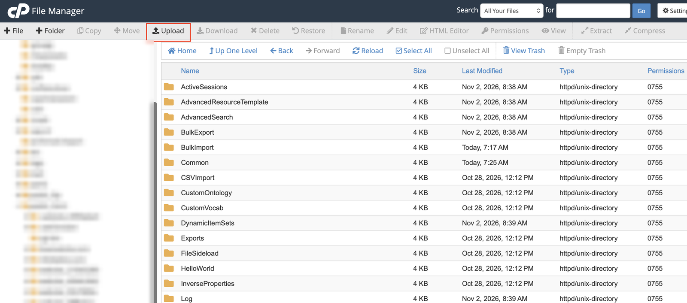
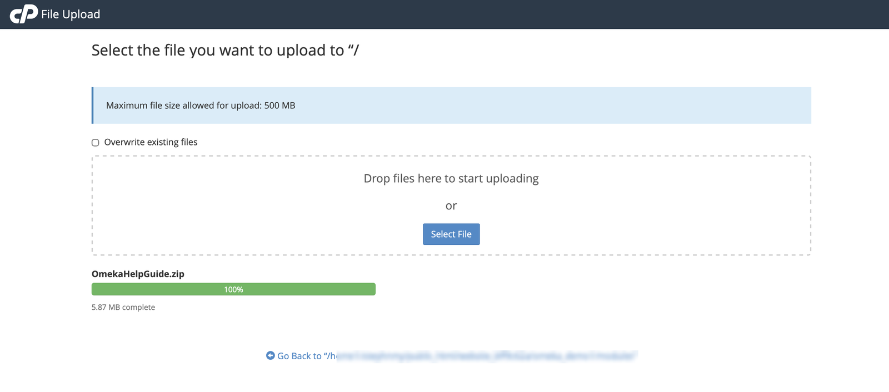
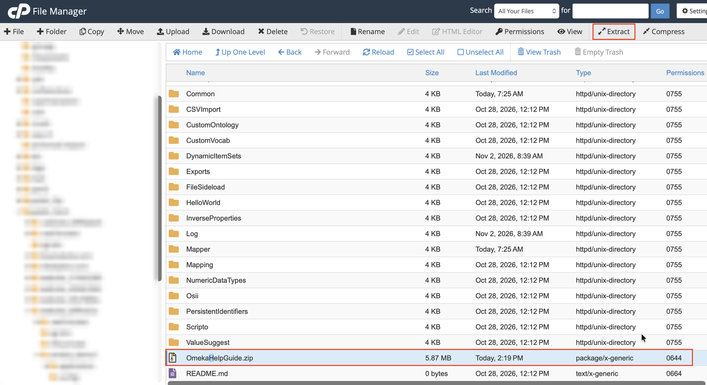
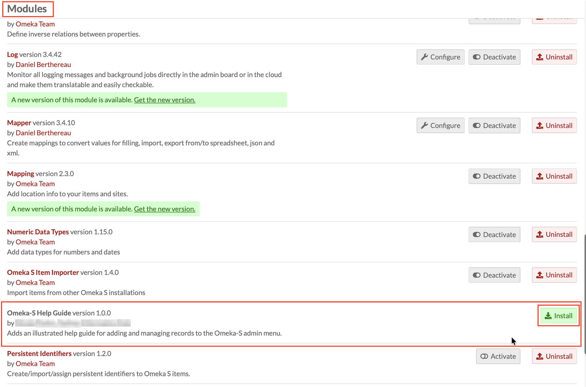
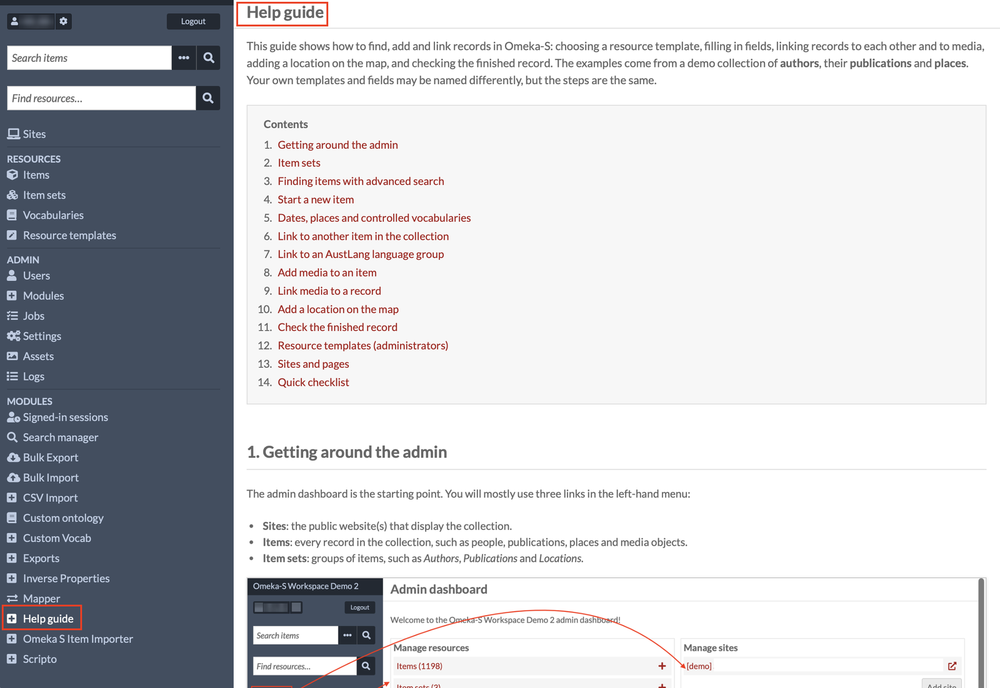

# Omeka-S Help Guide module

An Omeka-S module that adds an illustrated **Help guide** to the admin menu. The guide shows users how to find, add and link records: resource templates, item sets, advanced search, controlled vocabularies, linking records and media, AustLang language groups, mapping, applying templates, and sites.

- **Requirements:** Omeka-S 4.x
- **Download:** [OmekaHelpGuide.zip](OmekaHelpGuide.zip)

---

## Install

These steps use the cPanel **File Manager**, which most shared hosting providers offer. If you use FTP or another file manager, the steps are the same: put the `OmekaHelpGuide` folder in your Omeka-S `modules` folder.

### 1. Upload the zip to your modules folder

Download **OmekaHelpGuide.zip** from this repository. In File Manager, open your Omeka-S installation's **`modules`** folder and click **Upload**.

Select **OmekaHelpGuide.zip**. Wait until the upload shows **100%**, then click **Go Back** to return to the `modules` folder.

### 2. Extract the zip

Select **OmekaHelpGuide.zip** in the `modules` folder and click **Extract**. Extract it into the `modules` folder itself.

Check that you now have a folder called **`OmekaHelpGuide`** directly inside `modules`, not `modules/OmekaHelpGuide/OmekaHelpGuide`. Then delete the zip.

> The folder must be named exactly `OmekaHelpGuide`, or Omeka-S won't recognise the module.

### 3. Install the module in Omeka-S

Log in to the Omeka-S admin and go to **Modules**. Find **Omeka-S Help Guide** and click **Install**.

### 4. Open the guide

**Help guide** now appears in the left-hand menu under **Modules**. Every logged-in user can open it.

---

## Customise

The guide uses a demo collection as its example. To adapt it to your own collection:

- **Text:** edit `view/omeka-help-guide/admin/index/index.phtml`.
- **Screenshots:** replace the files in `asset/img/`, keeping the same file names. If a screenshot is missing, the guide shows a dashed placeholder box with the file name it expects.

## Update

Upload and extract the new zip into `modules`, replacing the existing files. If **Modules** shows an **Upgrade** button next to the module, click it.

## Uninstall

In **Modules**, click **Uninstall** next to *Omeka-S Help Guide*, then delete the `OmekaHelpGuide` folder. The module doesn't store anything in the database.
